<p align="center">
  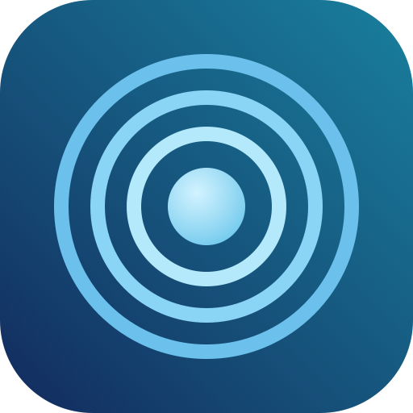
</p>

<h1 align="center">Breathia</h1>

<p align="center">
  Guided breathing for iPhone, iPad, Mac and Apple Watch with live heart-rate and HRV biofeedback.
</p>

<p align="center">
  
  
  
  
  
  
  
  <a href="LICENSE"></a>
  <a href="https://github.com/LinkAndreas/Breathia/actions/workflows/deploy.yml"></a>
</p>

Breathia paces you through 24 breathing techniques — from Box Breathing and the Physiological
Sigh to Resonance and Alternate Nostril Breathing — with a breathing circle and haptic and sound
cues. Connect any Bluetooth heart-rate sensor, such as the Polar H10, to see your heart rate
and HRV respond while you breathe.

## Screenshots

### iPhone

<table>
  <tr>
    <td align="center" valign="top"><picture><source media="(prefers-color-scheme: dark)" srcset="Docs/Images/Screenshots/iphone-session-dark.png">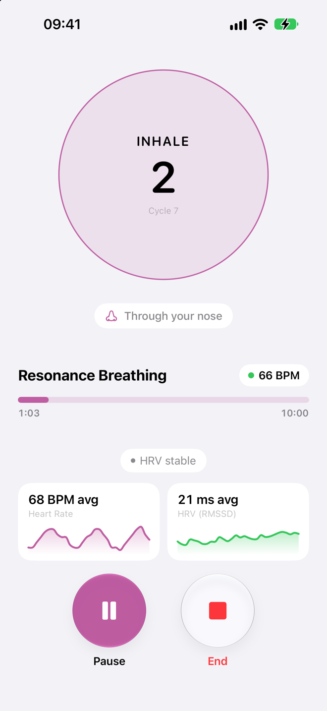</picture><br><sub>Live session with biofeedback</sub></td>
    <td align="center" valign="top"><picture><source media="(prefers-color-scheme: dark)" srcset="Docs/Images/Screenshots/iphone-breathe-dark.png">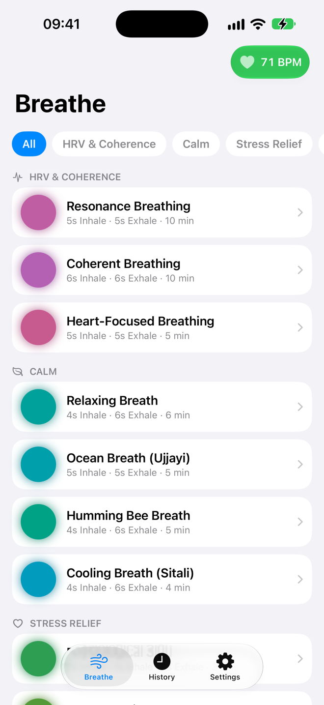</picture><br><sub>24 techniques by category</sub></td>
    <td align="center" valign="top"><picture><source media="(prefers-color-scheme: dark)" srcset="Docs/Images/Screenshots/iphone-technique-dark.png">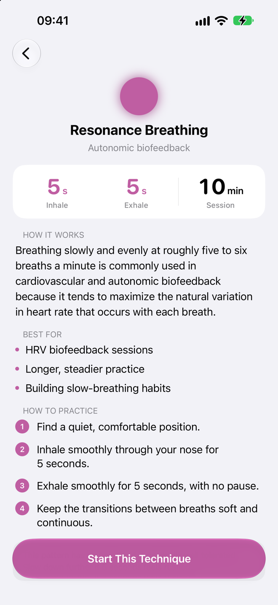</picture><br><sub>How each technique works</sub></td>
  </tr>
  <tr>
    <td align="center" valign="top"><picture><source media="(prefers-color-scheme: dark)" srcset="Docs/Images/Screenshots/iphone-historyDetail-dark.png">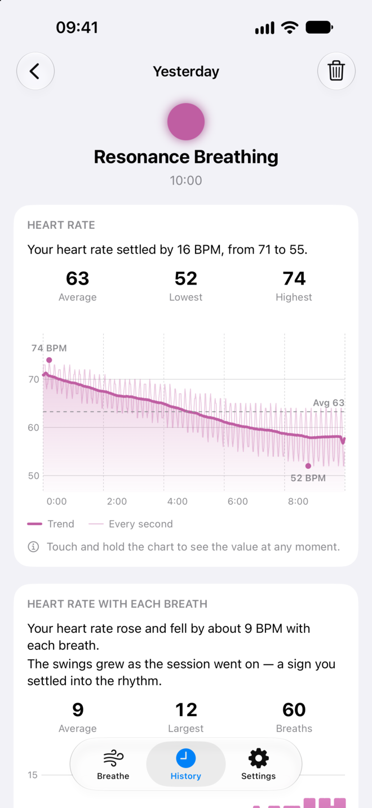</picture><br><sub>Session report</sub></td>
    <td align="center" valign="top"><picture><source media="(prefers-color-scheme: dark)" srcset="Docs/Images/Screenshots/iphone-history-dark.png">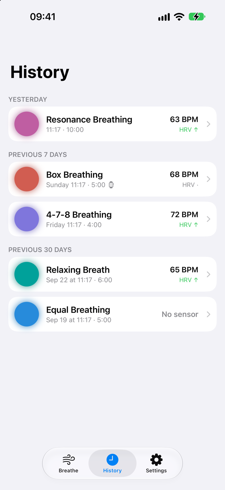</picture><br><sub>History</sub></td>
    <td align="center" valign="top"><picture><source media="(prefers-color-scheme: dark)" srcset="Docs/Images/Screenshots/iphone-settings-dark.png">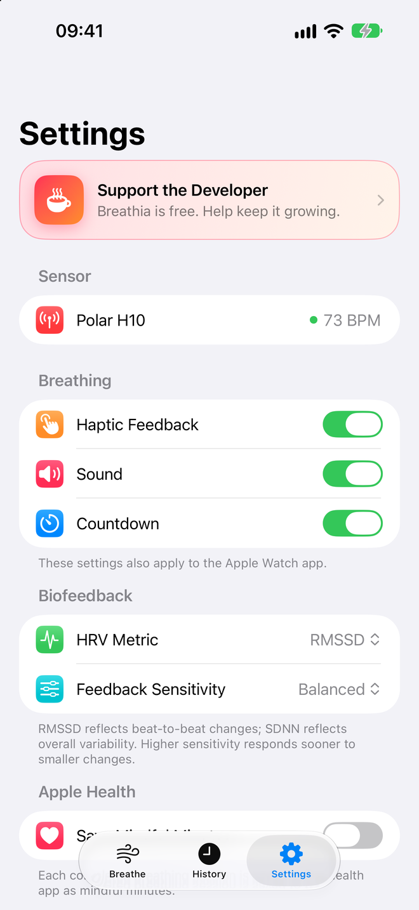</picture><br><sub>Settings</sub></td>
  </tr>
</table>

### iPad

<table>
  <tr>
    <td align="center" valign="top"><picture><source media="(prefers-color-scheme: dark)" srcset="Docs/Images/Screenshots/ipad-session-dark.png">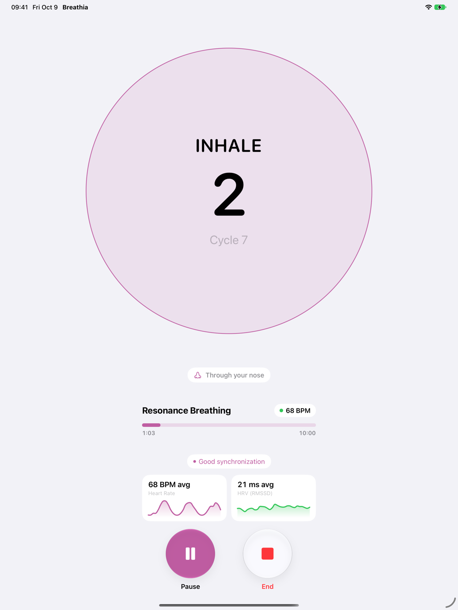</picture><br><sub>Live session</sub></td>
    <td align="center" valign="top"><picture><source media="(prefers-color-scheme: dark)" srcset="Docs/Images/Screenshots/ipad-breathe-dark.png">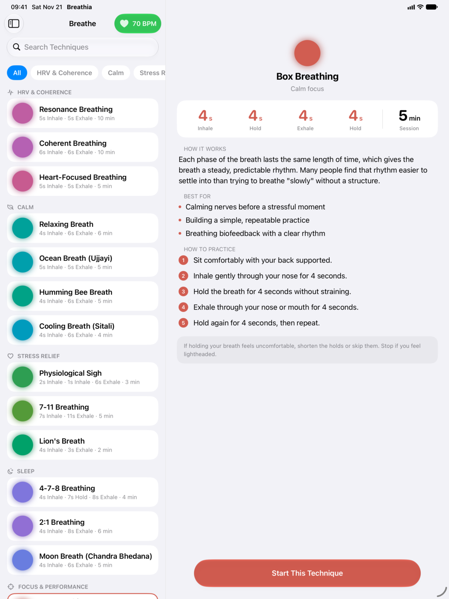</picture><br><sub>Techniques beside their details</sub></td>
    <td align="center" valign="top"><picture><source media="(prefers-color-scheme: dark)" srcset="Docs/Images/Screenshots/ipad-technique-dark.png">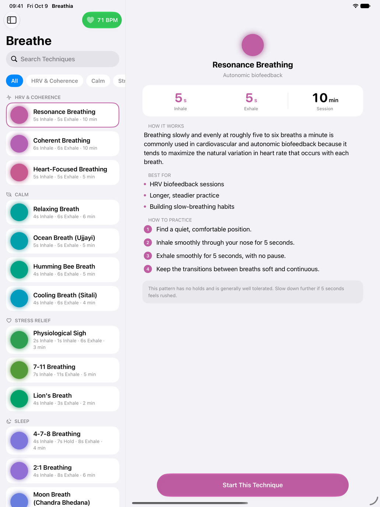</picture><br><sub>Technique details</sub></td>
  </tr>
  <tr>
    <td align="center" valign="top"><picture><source media="(prefers-color-scheme: dark)" srcset="Docs/Images/Screenshots/ipad-history-dark.png">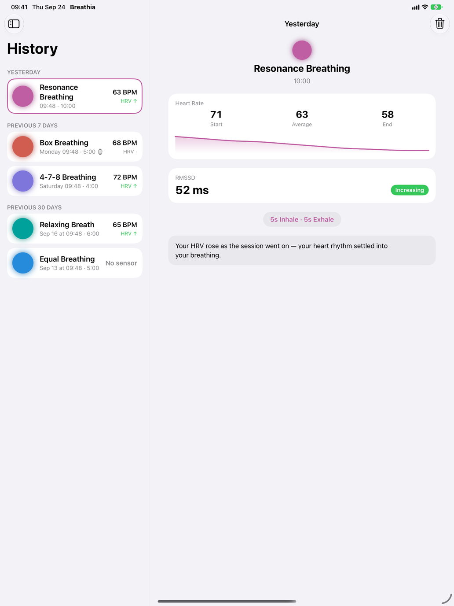</picture><br><sub>History with the session report</sub></td>
    <td align="center" valign="top"><picture><source media="(prefers-color-scheme: dark)" srcset="Docs/Images/Screenshots/ipad-settings-dark.png">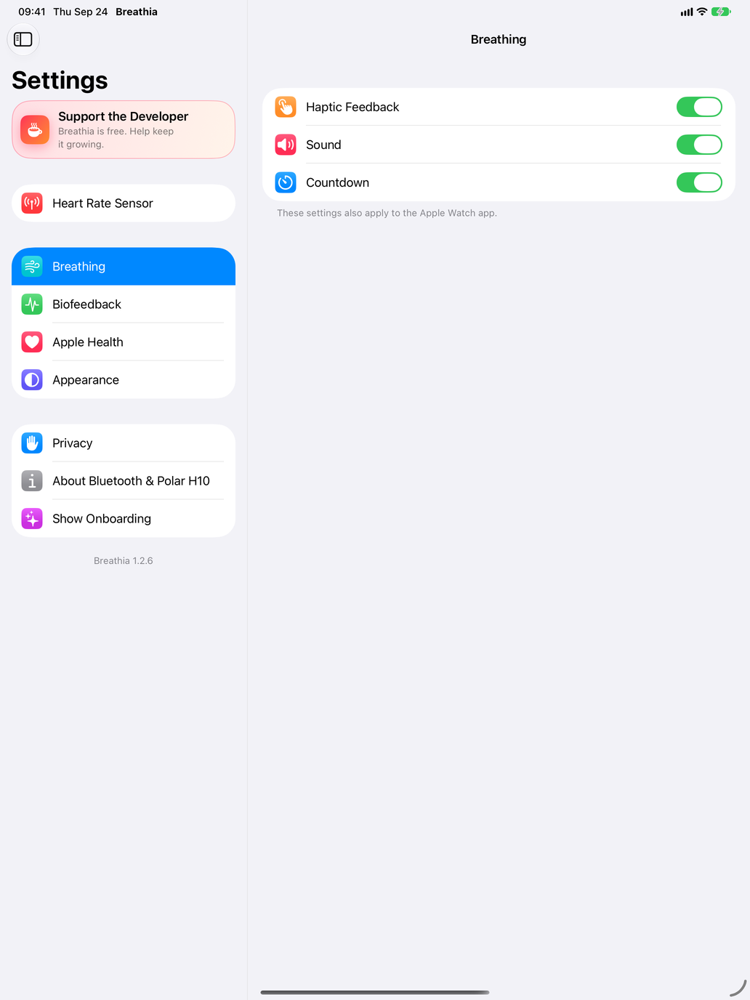</picture><br><sub>Settings</sub></td>
  </tr>
</table>

### Mac

<table>
  <tr>
    <td align="center" valign="top"><picture><source media="(prefers-color-scheme: dark)" srcset="Docs/Images/Screenshots/mac-session-dark.png">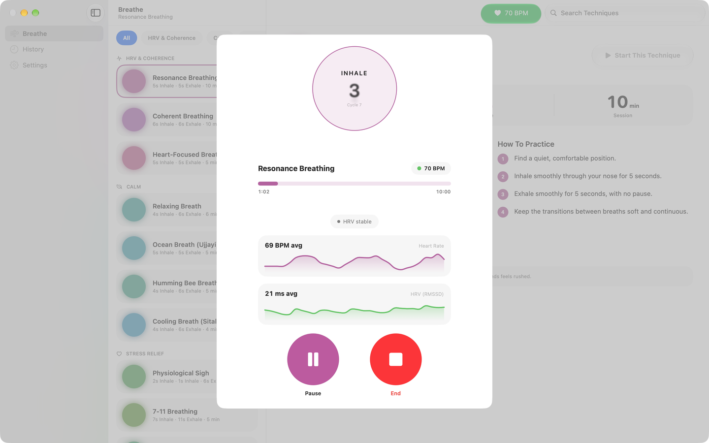</picture><br><sub>Live session</sub></td>
    <td align="center" valign="top"><picture><source media="(prefers-color-scheme: dark)" srcset="Docs/Images/Screenshots/mac-breathe-dark.png">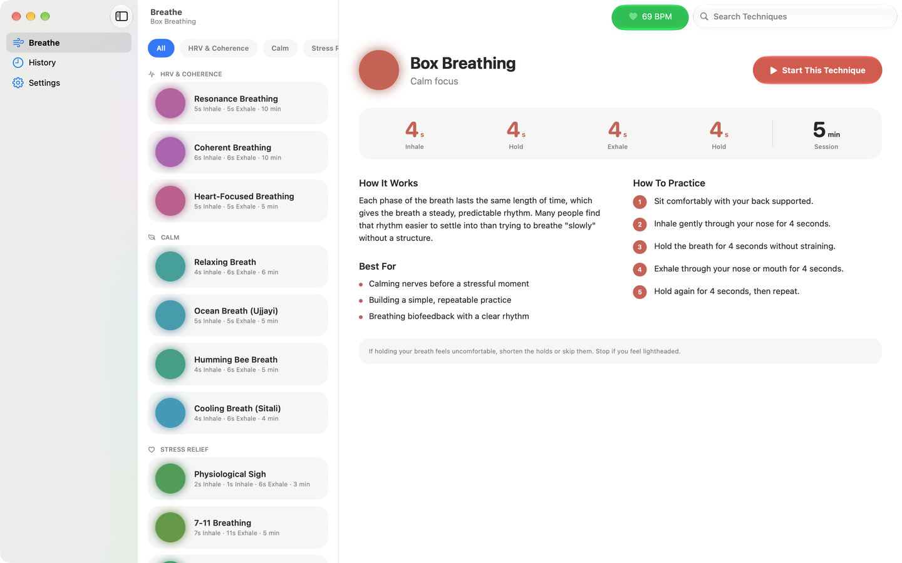</picture><br><sub>Techniques</sub></td>
  </tr>
  <tr>
    <td align="center" valign="top"><picture><source media="(prefers-color-scheme: dark)" srcset="Docs/Images/Screenshots/mac-history-dark.png">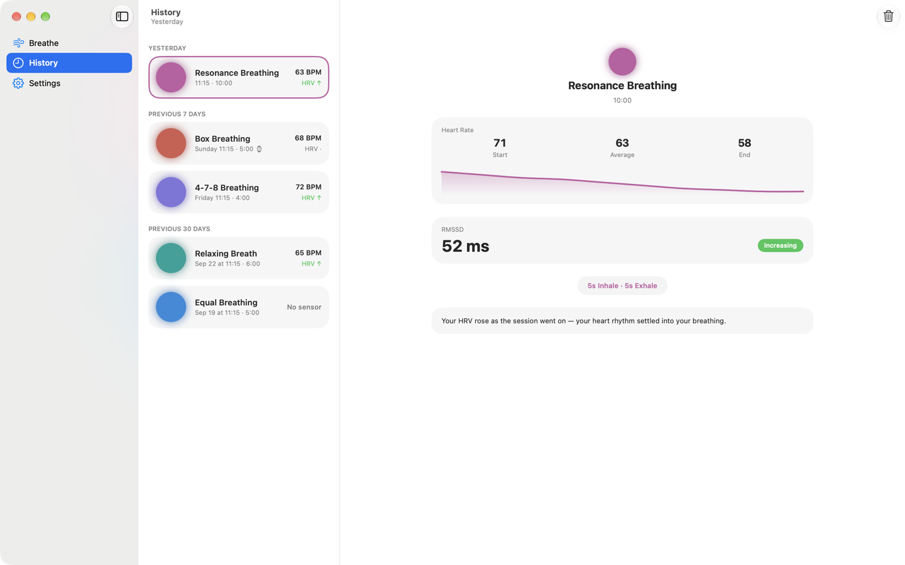</picture><br><sub>History</sub></td>
    <td align="center" valign="top"><picture><source media="(prefers-color-scheme: dark)" srcset="Docs/Images/Screenshots/mac-settings-dark.png">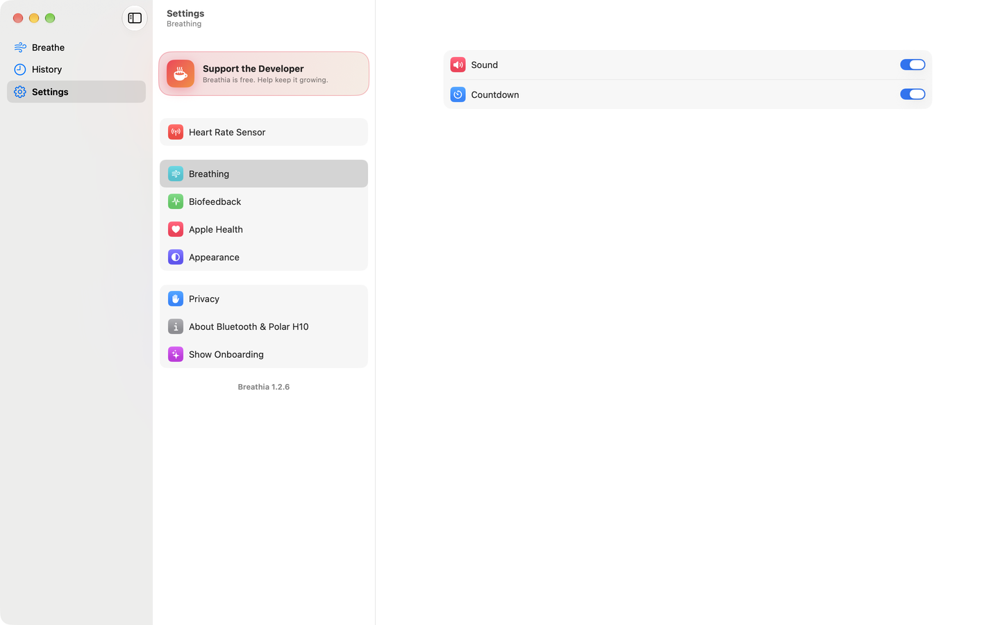</picture><br><sub>Settings</sub></td>
  </tr>
</table>

### Apple Watch

<table>
  <tr>
    <td align="center" valign="top">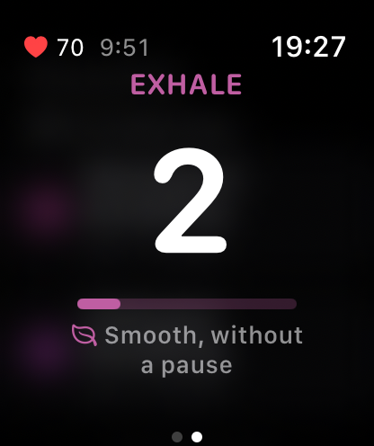<br><sub>Session on the wrist</sub></td>
    <td align="center" valign="top">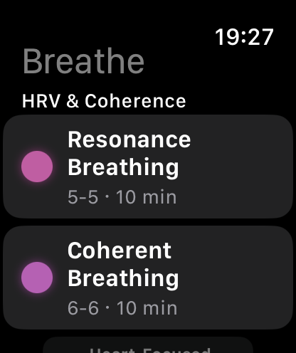<br><sub>Techniques</sub></td>
    <td align="center" valign="top">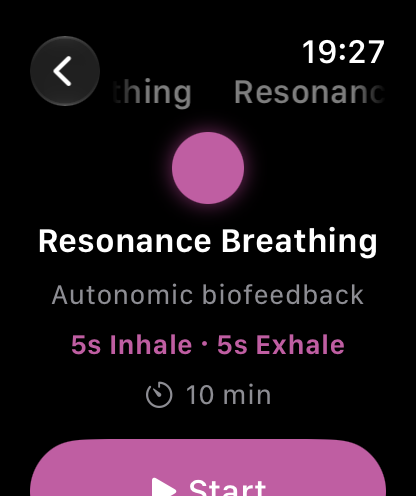<br><sub>Technique</sub></td>
    <td align="center" valign="top">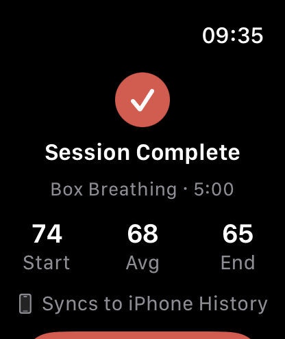<br><sub>Summary</sub></td>
  </tr>
</table>

## Features

- **24 techniques** in seven categories, each with how it works, what it's best for,
  step-by-step practice notes and safety guidance
- **Guided sessions** — a breathing circle that grows and shrinks with the breath; its count goes
  up while you breathe in and hold, and down while you breathe out. The screen stays on during a
  session, and leaving the app pauses it, so time away isn't counted.
- **Live biofeedback** — heart rate and HRV (RMSSD or SDNN) from a Bluetooth heart-rate sensor,
  with missed beats and readings without skin contact filtered out
- **Live Activity** — elapsed and total time with Pause, Resume and End on the Lock Screen and in
  the Dynamic Island
- **Apple Watch app** — sessions on the wrist with heart rate from a workout and haptic cues,
  synced to History on iPhone
- **History** — every session with its heart-rate and HRV trends, stored on device
- **Apple Health** — optionally saves sessions as mindful minutes
- **Sound cues** — four sounds (singing bowl, bell, wood, and a breath wave that rises and falls
  with the breath) with their own volume, played as media so they follow the volume buttons and
  headphones and mix with music
- **iPad and Mac** — a three-column layout; on the Mac, a native app with the same sound cues and
  Bluetooth sensor support
- **App icons** — eight icons to choose from in Settings; on iPhone and iPad the app takes on the
  chosen icon's colors
- **Free** — every feature included, with no ads and no in-app purchases
- **Localized** in English, German, Spanish and French

## Privacy

Breathia has no account and no server. History and settings stay on your devices; sessions reach
Apple Health only if you turn that on. Read the privacy policy in
[English](https://breathia.linkandreas.de/privacy/en/),
[German](https://breathia.linkandreas.de/privacy/de/),
[French](https://breathia.linkandreas.de/privacy/fr/) or
[Spanish](https://breathia.linkandreas.de/privacy/es/), see the
[terms of use](https://breathia.linkandreas.de/termsofuse/en/), or write to
[privacy@linkandreas.de](mailto:privacy@linkandreas.de).

## Requirements

- Xcode 27 or later
- iOS / iPadOS 27, macOS 27 and watchOS 27
- For biofeedback: a Bluetooth LE heart-rate sensor using the standard Heart Rate service.
  HRV needs a sensor that sends beat-to-beat (RR) intervals, such as the Polar H10; every
  session also works without a sensor.

The app has no third-party dependencies.

## Getting started

```bash
git clone <this repository>
open Breathia.xcodeproj
```

Choose the **Breathia** scheme and run it — no further setup is needed:

- **iOS Simulator** — has no Bluetooth, so it connects to a simulated heart-rate strap.
- **My Mac** — connects to a real sensor over Bluetooth.

The **BreathiaWatch** scheme runs the Apple Watch app.

### Running on a device

Signing is configured in [`Config/Signing.xcconfig`](Config/Signing.xcconfig) and can be
overridden locally without touching the project file:

```bash
cp Config/Local.xcconfig.example Config/Local.xcconfig
```

Then set your `DEVELOPMENT_TEAM` and a `BUNDLE_ID_PREFIX` you own in `Config/Local.xcconfig`
(it's git-ignored). The targets use `<prefix>.breathia`, `<prefix>.breathia.watchkitapp`,
`<prefix>.breathia.widgets` and `<prefix>.breathia.tests`.

### Deploying to App Store Connect

The [Deploy to App Store Connect](.github/workflows/deploy.yml) workflow runs on every merge into
`main` and can also be started manually from the Actions tab. It archives the iOS app with the Watch app and widgets, uses the run number as
build number, and uploads the build to App Store Connect. It needs these repository settings:

| Kind     | Name                                                        | Value                                                    |
| -------- | ----------------------------------------------------------- | -------------------------------------------------------- |
| Variable | `TEAM_ID`                                                   | Apple Developer team ID                                  |
| Variable | `BUNDLE_ID_PREFIX`                                          | Bundle identifier prefix, e.g. `de.linkandreas`          |
| Secret   | `API_KEY_ID`, `API_KEY_ISSUER_ID`                           | App Store Connect API key ID and issuer ID               |
| Secret   | `API_KEY_BASE64`                                            | The API key's `.p8` file, base64-encoded                 |
| Secret   | `SIGNING_CERTIFICATE_BASE64`, `SIGNING_CERTIFICATE_PASSWORD` | iPhone/Apple Distribution certificate as `.p12`, and its password |
| Secret   | `KEYCHAIN_PASSWORD`                                         | Any password for the temporary CI keychain               |
| Secret   | `PROVISIONING_PROFILE_BASE64`, `PROVISIONING_PROFILE_NAME`  | App Store profile for `<prefix>.breathia`                |
| Secret   | `WATCH_PROVISIONING_PROFILE_BASE64`, `WATCH_PROVISIONING_PROFILE_NAME` | App Store profile for `<prefix>.breathia.watchkitapp` |
| Secret   | `WIDGETS_PROVISIONING_PROFILE_BASE64`, `WIDGETS_PROVISIONING_PROFILE_NAME` | App Store profile for `<prefix>.breathia.widgets` |

Encode files with `base64 -i <file> | pbcopy`.

## Tests

`BreathiaTests` covers the logic where mistakes are costly: the breathing clock, HRV calculation
and artifact filtering, heart-rate packet parsing, session recording, pausing and leaving the
app, History, settings compatibility, and the rating prompt. The tests need no device, sensor or
HealthKit.

```bash
xcodebuild test -project Breathia.xcodeproj -scheme Breathia -destination 'platform=macOS'
```

Or press ⌘U in Xcode.

## Project structure

| Folder | Contents |
|---|---|
| `Breathia/` | iPhone, iPad and Mac app (one multiplatform target) |
| `BreathiaWatch/` | Apple Watch app |
| `BreathiaWidgets/` | WidgetKit extension drawing the Live Activity |
| `Shared/` | Domain, stores, design system, string catalogs and the app icon — compiled into both apps |
| `LiveActivityShared/` | Live Activity attributes and intents, shared by the app and the widget extension |
| `Config/` | Entitlements, Info.plists and signing |
| `BreathiaTests/` | Unit tests (Swift Testing), hosted by the app |
| `Docs/` | Architecture notes and the README's images |

The code is layered into Domain, Infrastructure, Stores and Features, with Apple frameworks kept
behind protocols. [`Docs/Architecture.md`](Docs/Architecture.md) describes the layers, platform
differences, sessions, heart-rate data quality, navigation, History, the Live Activity,
localization and tests.

## Localization

All user-facing text lives in [`Shared/Localizable.xcstrings`](Shared/Localizable.xcstrings)
under semantic keys (for example `technique.box.name`), with English as the source language.
App name and permission prompts are in [`Shared/InfoPlist.xcstrings`](Shared/InfoPlist.xcstrings).

## Branches

The repository follows git flow:

- `main` — released versions, tagged (for example `v1.0.0`)
- `develop` — the next release; branch from here
- `feature/<name>` — one feature or fix, merged into `develop`
- `release/<version>` — final preparation, merged into `main` and back into `develop`

## Feedback

Questions and ideas are welcome at [feedback@linkandreas.de](mailto:feedback@linkandreas.de), or
open an issue.

## Disclaimer

Breathia is a wellness tool. It is not a medical device and isn't intended to diagnose or treat
any condition. Some techniques aren't suitable for everyone — read each technique's safety
note, and stop if you feel unwell.

## License

Breathia is available under the MIT license. See [LICENSE](LICENSE).

The name "Breathia" and the app icon identify the published app; please use your own name and
icon if you ship a fork on the App Store.
